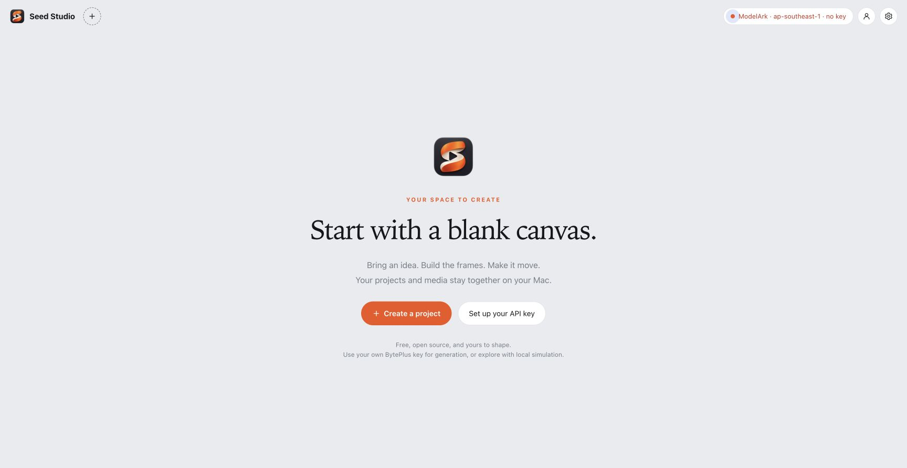

<p align="center">
  
</p>

<h1 align="center">Seed Studio</h1>

<p align="center"><strong>Your creative workspace for Seedream and Seedance on Mac.</strong></p>
<p align="center">Turn an idea into images, storyboards and video in one desktop app.<br>Bring your BytePlus ModelArk API key. Keep your projects on your Mac.</p>

<p align="center">
  <a href="LICENSE">MIT licensed</a> ·
  <a href="https://github.com/awsnasser/seed-studio/releases">Releases</a> ·
  <a href="#get-started">Get started</a> ·
  <a href="ROADMAP.md">Roadmap</a> ·
  <a href="https://github.com/awsnasser/seed-studio/issues/new/choose">Suggest a feature</a>
</p>

Seed Studio brings ByteDance's Seed model family into a Mac workflow through **BytePlus ModelArk**, its international API service. Chat, reference images, a visual node canvas and generated video stay together inside each project.

**The app is free and open source.** You can use, modify and share it under the MIT license. Live generation uses your own provider account and is billed by that provider. Local simulation lets you explore the workflow without an API key.



## Make a complete sequence

1. **Start with an idea.** Write in chat, add project instructions, or import a storyboard and references.
2. **Build the frames.** Generate and edit with Seedream, reuse character references, and keep earlier image versions.
3. **Connect the shots.** Arrange prompts, images, voice clips and video nodes on one canvas.
4. **Make it move.** Generate with Seedance 2.5 or **Seedance 2.5 Flash**, then save the results to your Mac.

## What you can do

| Workflow | Included |
| --- | --- |
| Images | Text-to-image, reference-based editing, aspect ratios, image versions and a project gallery |
| Video | Seedance tasks from chat and canvas, first/last-frame or reference-image workflows, audio references and saved task progress |
| Seedance 2.5 Flash | 480p and 720p video, 4–30 seconds, with model-specific controls |
| Canvas | Connectable nodes, groups, notes, undo/redo, batch runs and a tool-using canvas assistant |
| Storyboards | Import prompts, image sets and shot packages to build repeatable sequences |
| Creative continuity | Named character, environment and prop references through Elements |
| Local workspace | SQLite projects, local media, macOS Keychain credentials, light/dark/system appearance |

Seedance 2.5 supports draft-to-final workflows. Flash generates directly at its supported resolutions. Model access depends on activation and availability in your provider account. [BytePlus Seedance documentation](https://docs.byteplus.com/en/docs/ModelArk/seedance-2-5)

## Get started

### Download for Mac

[Download Seed Studio 0.2.0 for Apple silicon](https://github.com/awsnasser/seed-studio/releases/download/v0.2.0/Seed-Studio-0.2.0-Apple-Silicon.dmg), open the disk image, and drag **Seed Studio** into **Applications**.

The app starts with an empty workspace. Create your first project, then add your own BytePlus key in Settings or choose local simulation. The app is free; your provider bills live generation. This initial download uses ad-hoc signing and has not been notarized by Apple. Intel Mac users can build from source below.

### Build on your Mac

Install Xcode Command Line Tools, a current stable Rust toolchain, Node.js 22 or later, and pnpm 10.33.2. The application targets macOS 11 or later. Builds and compatibility checks are being developed on Apple silicon. [Tauri prerequisites](https://v2.tauri.app/start/prerequisites/)

```bash
git clone https://github.com/awsnasser/seed-studio.git
cd seed-studio
pnpm install --frozen-lockfile
pnpm tauri dev
```

To create a Mac application and disk image for your machine's architecture, run

```bash
pnpm package:mac
```

The build writes the `.app` to `src-tauri/target/release/bundle/macos/` and the `.dmg` to `src-tauri/target/release/bundle/dmg/`.

Check each [GitHub release](https://github.com/awsnasser/seed-studio/releases) for available downloads, supported architecture and signing status. Current builds use ad-hoc signing. Distributing a Developer ID signed and notarized build requires the maintainer's Apple credentials. [Tauri macOS signing guide](https://v2.tauri.app/distribute/sign/macos/)

### Connect your API key

1. Create a BytePlus ModelArk account and activate the models you want to use.
2. In Seed Studio, open **Settings → Provider → BytePlus ModelArk**.
3. Choose the same region as your provider account.
4. Enter your key in the app and click **Save & check**. The native app stores it in macOS Keychain.
5. Use **Test** beside a chat model to verify access. That test sends a small, billable request. Image and video access is verified when you generate with those models.

Use **Local simulation** in Settings to try the interface with sample results. The built-in connection targets BytePlus ModelArk. A key for another ByteDance platform may require a different API integration.

The release contains no API keys, signed-in accounts, configured team server, saved projects or imported media. First launch opens an empty workspace. Create and name your own project, then connect your own provider account. Only the official BytePlus regions are preconfigured.

### Your first storyboard

Create a project, open **Canvas**, and right-click to add an image generation node. Enter a prompt and generate a frame. Connect the result to a video generation node, choose a Seedance model, and describe the movement. The node shows progress and keeps the completed output in your project.

For a larger sequence, use the storyboard importer to create several shots, then run the selected nodes. The interface displays the number of requests and offers **Stop the rest** during a batch. Requests already submitted can incur provider charges.

## Data and privacy

Projects and media live in `~/Library/Application Support/com.seedstudio.desktop/`. API keys and optional team sign-in tokens use macOS Keychain. Prompts and selected media are sent to the provider when you request generation or use the assistant.

The request log records request metadata, statuses and reported usage. Provider error messages can contain request details, so review logs before sharing them. Back up your local application data before experimenting with development builds or migrations.

Optional team features provide accounts and eight-seat sessions using a Supabase project you operate. Shared project editing is planned. Individual creative work works without a Supabase setup. [Team setup](docs/TEAM-SETUP.md)

## Built to keep growing

We aim to ship **new features and improvements each month**. The roadmap is public, and release notes document what has shipped. Feature requests, reproducible bug reports, documentation improvements and pull requests are welcome.

If Seed Studio helps your workflow, star the repository, share a creation you have permission to publish, or help someone get started. [Roadmap](ROADMAP.md) · [Contributing](CONTRIBUTING.md) · [Changelog](CHANGELOG.md)

## Develop and test

```bash
pnpm check:release
pnpm build
cargo test --manifest-path src-tauri/Cargo.toml --locked --features devserver
```

Tests use simulation or local mock servers. Provider credentials are supplied only through the application for manual testing.

For browser-based UI development, run `pnpm devserver` in one terminal and `pnpm dev` in another. This development bridge uses memory-only credentials and a separate `.devdata` folder. Stop it when you finish development.

| Area | Source |
| --- | --- |
| React interface | `src/` |
| Rust core, storage and validation | `src-tauri/src/` |
| Model IDs and capabilities | `config/seed-catalog.json` |
| Integration tests | `src-tauri/tests/flow.rs` |
| Optional team backend | `supabase/` |
| Canvas implementation | [Canvas guide](docs/CANVAS.md) |

Seed Studio is an independent community project. ByteDance, BytePlus, Seedream and Seedance names identify their respective services and models. The MIT license covers this application's code. Provider terms govern API access and generation.
